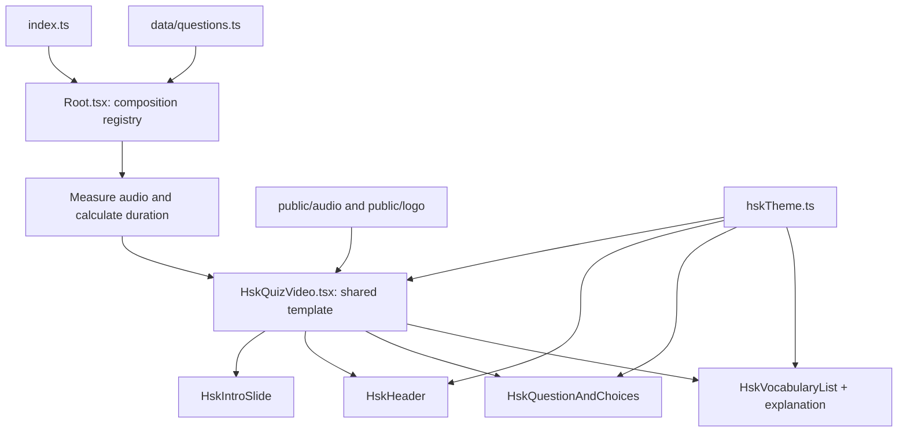

# HSK Remotion Project Guide

This project uses one reusable Remotion template to render each HSK listening question in landscape and vertical formats.

Question and vocabulary phases use `public/background/bg3-landcape.jpg` in landscape and `public/background/bg3-vertical.jpg` in vertical format. A subtle dark overlay keeps text legible. The intro slide retains its own background design.

## Project structure

```text
my-projects/
├── public/
│   ├── audio/                 # Intro, question, and countdown recordings
│   └── logo/                  # Shared channel logo
├── scripts/
│   └── render-hsk.mjs         # Render one question or a batch
└── src/
    ├── index.ts               # Remotion entry point
    ├── Root.tsx               # Registers compositions and calculates durations
    ├── HskQuizVideo.tsx        # Shared timeline and phase flow
    ├── components/
    │   ├── HskIntroSlide.tsx   # Intro title card
    │   ├── HskHeader.tsx       # Brand header (logo and HSK level)
    │   ├── HskQuestionAndChoices.tsx # Prompt, four choices, and answer highlight
    │   └── HskVocabularyList.tsx     # Vocabulary cards and grammar explanation
    ├── data/questions.ts      # Typed question content and audio paths
    ├── styles/hskTheme.ts     # Shared colors and responsive layout tokens
    └── cautruc.md             # This guide
```

## What each part does

| File | Responsibility |
| --- | --- |
| `index.ts` | Registers `RemotionRoot` so Remotion can discover the compositions. |
| `Root.tsx` | Creates one composition per question and aspect ratio. It checks aligned data, measures audio assets, and provides the complete duration to the template. |
| `data/questions.ts` | Defines the `HskQuestion` type, shared intro audio paths, and question records. Add a question here to reuse the existing video template. |
| `HskQuizVideo.tsx` | Plays audio in timeline order and selects the preview, listening, thinking, replay, answer, or vocabulary phase. It arranges the header, main area, and footer. |
| `components/HskIntroSlide.tsx` | Displays the green-and-beige title artwork and the active question prompt (for example, “Câu 1.1”) while intro 1 plays. |
| `components/HskOutroSlide.tsx` | Displays the shared thank-you and follow card with a gently bouncing arrow. |
| `components/HskHeader.tsx` | Reuses the logo header with a brand title during quiz phases and “Từ vựng và cấu trúc đáng nhớ” during vocabulary review. The question ID is intentionally omitted. |
| `components/HskQuestionAndChoices.tsx` | Displays the prompt and four choices; during answer reveal, aligns Chinese and pinyin on the left with Vietnamese meaning on the right, and highlights the correct choice in green. |
| `components/HskVocabularyList.tsx` | Maps the variable-length vocabulary arrays into cards and shows a separate, highlighted grammar explanation panel beneath them. |
| `styles/hskTheme.ts` | Centralizes shared colors, spacing, safe areas, and format-specific font/layout sizes. |
| `scripts/render-hsk.mjs` | Provides npm commands to render one question or batches. |
| `scripts/generate-outro-chime.mjs` | Creates the short, dependency-free chime at `public/audio/sfx/outro-follow-chime.wav`. Run it with `npm run generate:outro-chime`. |

## Question data

Each record includes an ID, level, audio path, prompt, four choices with matching pinyin and Vietnamese meanings, answer, Chinese transcript, matching pinyin and Vietnamese translation lines, vocabulary arrays, and an explanation array. Keep the four choice arrays aligned. `vocabs`, `vocabsPinyin`, and `vocabsMeaning` are variable-length string arrays: keep their item counts and indexes aligned. The transcript, pinyin, and Vietnamese lines should also align by index. Prefix the question line with a speaker label (such as `问:` / `Hỏi:`) to highlight both versions in red.

Each explanation array item contains four strings: `structure`, `example`, `examplePinyin`, and `exampleMeaning`. The vocabulary screen maps each item to its own numbered card (for example, “Cấu trúc 1” and “Cấu trúc 2”). Add another array item to display another structure. Render these individual strings; do not render an object itself as a React child.

## Code flow and video timeline



For each composition, the template runs these phases in order:

1. **Intro 1:** show the title slide and play `intro1`.
2. **Intro 2 / preview:** play `intro2` while showing the prompt and four choices.
3. **Listen:** play the question audio and animate the waveform.
4. **Think:** play the countdown sound for its measured duration and show a rotating arrow with the remaining seconds.
5. **Replay:** replay the full question audio and show Chinese transcript lines with matching pinyin in a highlighted panel. The question line is red.
6. **Answer:** show the correct choice, each choice's Chinese/pinyin and Vietnamese meaning in two columns, and Vietnamese transcript lines. The question line is red.
7. **Vocabulary:** show the shared header, mapped vocabulary cards, and the separate grammar explanation panel.
8. **Outro:** play a light ascending chime and show the thank-you card for at least six seconds.

`Root.tsx` measures real audio lengths and calculates phase boundaries so the audio is not shortened by a guessed duration. The answer phase lasts seven seconds; vocabulary review duration grows by four seconds per vocabulary item; the outro is at least six seconds long. `HskQuizVideo.tsx` owns the timeline, while the display components and theme are shared by all question compositions and both aspect ratios.

## Add another question

1. Put its MP3 in `public/audio/` and record the relative path in a new `hskQuestions` entry.
2. Add prompt, exactly four choices with aligned pinyin and meanings, answer, aligned transcript arrays, vocabulary arrays, and explanation strings in `src/data/questions.ts`.
3. Keep vocabulary words, pinyin, and meanings at the same length and order. `Root.tsx` validates the data and resolves audio metadata when registering compositions.
4. Render one question first; then use the batch scripts when it looks correct.

The composition IDs follow the question and format, for example `HSK-Q01-Landscape` and `HSK-Q01-Vertical`. Output files are grouped under `out/landscape/` and `out/vertical/`.

## Render commands

Render a single vertical test video:

```powershell
npm.cmd run render:hsk:one -- Q01 vertical
```

Use `landscape` instead of `vertical` to test the horizontal layout. Batch commands:

```powershell
npm.cmd run render:hsk:landscape
npm.cmd run render:hsk:vertical
npm.cmd run render:hsk:all
```
